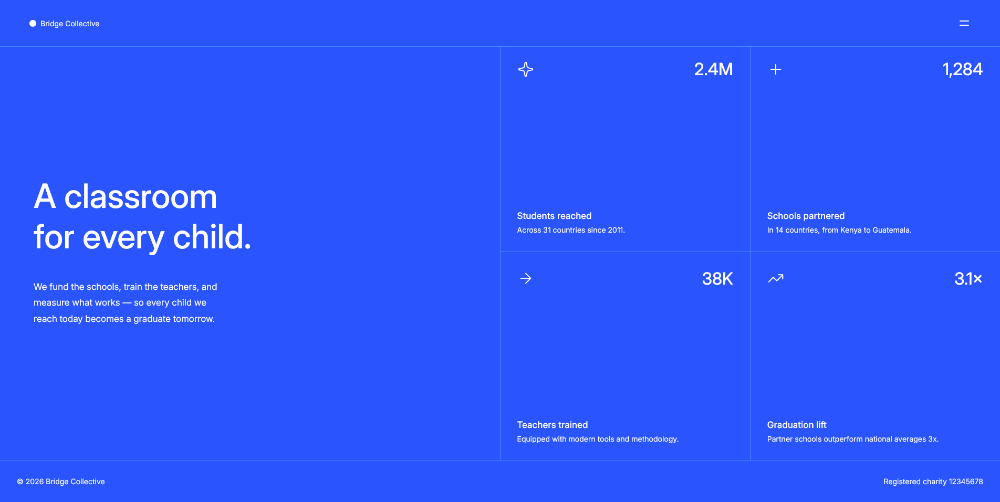

# Frontend Mentor - Grid landing page solution

This is a solution to the [Grid landing page challenge on Frontend Mentor](https://www.frontendmentor.io/challenges/grid-landing-page). Frontend Mentor challenges help you improve your coding skills by building realistic projects.

## Table of contents

- [Overview](#overview)
    - [The challenge](#the-challenge)
    - [Screenshot](#screenshot)
    - [Links](#links)
- [My process](#my-process)
    - [Built with](#built-with)
    - [What I learned](#what-i-learned)
    - [Continued development](#continued-development)
    - [Useful resources](#useful-resources)
- [Author](#author)

## Overview

### The challenge

Users should be able to:

- View the optimal layout for the page depending on their device's screen size
- See hover and focus states for all interactive elements on the page
- Open and close the navigation menu at any screen size (optional JavaScript)

### Screenshot

### Links

- Solution URL: [Add solution URL here](https://your-solution-url.com)
- Live Site URL: [Add live site URL here](https://your-live-site-url.com)

## My process

### Built with

- Semantic HTML
- Grid
- Flexbox
- Typescript

### What I learned

I learned how to use the `:has()` selector in CSS and learned about the HTML `inert` attribute

### Useful resources

- [Easings.net](https://easings.net) - Very helpful for finding easing functions for animation in code, specifically JS
- [MDN Web Docs](developer.mozilla.org) - Insanely useful as a reference for HTML, CSS and JS

## Author

- Frontend Mentor - [@fl4mxr1](https://www.frontendmentor.io/profile/fl4mxr1)
- Twitter - [@flooooour](https://x.com/flooooour)
